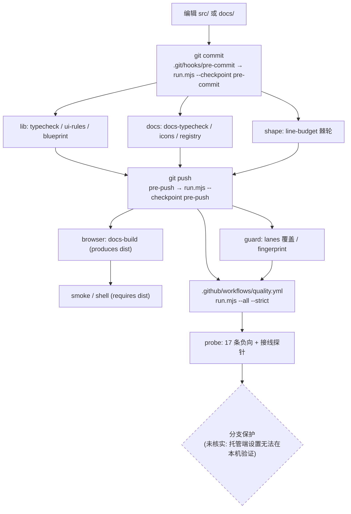

# HX-UI 代码质量全景

> 测量日期 **2026-10-04**，仓库 `components/HX-UI`（git 根 `/home/hx/Loli/code/HXLoLis/components/HX-UI`，
> 独立仓库，父仓 `HXLoLis` 以 gitlink 引用它）。HEAD 取证时 `16d6dfb`，工作区有未提交改动。
> 本文只描述**这个仓库**的现状；每项都给了可复算的命令，数字变化请重跑而不是引用本表。

## 一、仓库边界与形态

HX-UI 是一个 React 19 + TypeScript 5 的 UI 组件库，外加一个 38 页的可交互文档站。
`git ls-files` = 141 个文件，源码 117 个 `.ts/.tsx`，共 19,295 行。

| 层 | 路径 | 说明 |
|---|---|---|
| 令牌 | `src/tokens.css` | 零依赖，颜色/圆角/阴影/字体/图表色序 |
| 桥接 | `src/styles.css` | Tailwind v4 `@theme inline` 映射 |
| 组件 | `src/primitives/` `src/layout/` `src/charts/` `src/blueprint/` | 66 个模块，全部从 `src/index.ts` 导出 |
| 文档站 | `docs/` | 独立 package（自己一份 `package.json` / `tsconfig.json` / `vite.config.ts`），hash 路由，38 页 |
| 门禁 | `scripts/` | 见第三节 |

**跨仓依赖（必须显式知道，否则 CI 与本地行为不一致）**：`docs/vite.config.ts` 的 alias 与
`scripts/check-blueprint.mjs` 的打包入口都指向 `../../HX-Blueprint-Demo/src/*`，而那是
**父仓的普通目录**（`git ls-files components/HX-Blueprint-Demo` 有 8 个文件），不在本仓里。
单独 clone 本仓时 `check-blueprint` 会因 `UNRESOLVED_IMPORT` 失败 —— 实测过，见 `.github/workflows/quality.yml`
里那段 sparse-checkout。

## 二、现状：已有的防线（都是真的在跑吗）

| 入口 | 组成 | 实测耗时 | 结论 |
|---|---|---|---|
| `npm run build` | tsc + check-ui-rules + check-blueprint | 2.8s | 在跑 |
| `npm run verify` | build + docs build + smoke + shell | ~24.5s | 在跑；**2026-10-04 实跑全绿** |
| `docs/package.json` 的 `verify` | docs typecheck + icons + build + smoke + shell | — | `check:icons` 此前红，见下 |

五条既有门禁（都在 `scripts/` 与 `docs/scripts/`），**每条都有头部注释说明"拦什么、为什么需要它"**——
这是本仓已经做得很好的部分，必须保留：

| 脚本 | 拦什么 | 实测耗时 | 备注 |
|---|---|---|---|
| `check-ui-rules.mjs` | 硬编色 / 非语义调色盘 / 非 1px 边框 / 漏写 `type` 的 button | 33ms | 4 条规则 + 1 条跨行检查；白名单是文件级的（行号会漂移） |
| `check-smoke.mjs` | 逐页浏览器渲染，抓"渲染出来但是空的" | 17.5s | 40 页；DOM < 20KB 或没有 `<h1>` 即失败 |
| `check-shell.mjs` | 主题三态 / ⌘K 搜索 / 目录锚点 / 表格行点击 / 窄屏导航 | 1.7s | 断言**行为**而非存在性 |
| `check-blueprint.mjs` | 蓝图纯逻辑 171 条断言 | 1.0–2.7s | 先 vite 打包纯逻辑层再断言真实源码 |
| `docs/scripts/check-icons.mjs` | Iconify 类串名字（TS 与 Tailwind 都管不到） | 63ms | 193 处引用 |

### 取证发现的三个**真实缺口**（本轮修掉的）

**缺口一：`nav` 有页面而 `App.tsx` 没有对应 case 时，冒烟会放行（实测）。**
`docs/src/App.tsx` 的 `renderPage` 有 `default: return <PlaceholderPage .../>`。往 `docs/src/nav.ts`
注入一个没有 case 的 id 后：

```
check-smoke: 41 个页面, chromium=/usr/bin/chromium
check-smoke: 通过 (41/41 页渲染正常)      ← exit 0
```

页面有 `<h1>`、DOM 体积达标，**唯一会打开浏览器的门禁被完美绕过**。这是"渲染正常但内容不是你要的"，
冒烟在原理上抓不到它。判据：注册表四方对账（nav ↔ App 分支 ↔ 页面文件 ↔ 图标 ↔ 库导出）。

**缺口二：文档站类型检查从未被任何入口调用。**
`docs/package.json` 有 `typecheck`，但根 `package.json` 的 `verify` 跑的是 `npm --prefix docs run build`
（`vite build`），不是 `docs run verify`。实测 `tsc -p docs/tsconfig.json` **13 个错误、exit 2**：

```
../src/primitives/button.tsx(57,4): error TS2322: Type '{ ref?: Ref<HTMLButtonElement>; ... }'
  is not assignable to type 'ClassAttributes<HTMLButtonElement>'.
```

根因是**两份 `@types/react` 实例**：`docs/node_modules/@types/react` 与 `node_modules/@types/react` 都是
19.3.0 但被解析成两个不同身份，React 的 `Ref<>` 类型跨不过去。`vite.config.ts` 里已经用
`dedupe: ["react","react-dom"]` 处理了**运行时**的同一问题，类型层没有对应处理。
修法是 docs 的 `tsconfig.json` 用 `paths` 把 `react` / `react-dom` / `react/jsx-runtime` 指向仓库根那份。

**缺口三：`check:icons` 一直在红，而没人跑它。**
`docs/src/navIcons.ts:52` 的 `icon-[solar--nodes-linear]` 在 solar 集（8859 个图标）里不存在；
实测 `npm run check:icons` → `exit=1`。它此前从未在 `npm run verify` 里被调用，所以没人发现。

### 明确**不适用**的候选（附扫描证据）

| 类别 | 证据 | 裁决 |
|---|---|---|
| Python 侧全部（REF-1..15、PY-01..04） | `git ls-files '*.py' \| wc -l` = **0** | 整组不适用 |
| 后端契约 / 路由对账（REF-6, REF-10, REF-21） | 本仓不发请求、不起服务；`fetch(`/`axios` 命中 1 处且是 `refetch()` 变量名 | 不适用 |
| 测试框架类（REF-14, REF-22 vitest, REF-31 playwright e2e） | 无 `*.test.*` / `*.spec.*`；`vitest`/`playwright` 均未安装 | **见第六节待裁决** |
| 内联凭据（REF-12） | 本仓是纯 UI 库，无凭据使用面 | 不适用 |
| 覆盖率门禁（REF-15） | 无测试 → 无覆盖率可采集 | 不适用 |

## 三、本轮接线的门禁（每条的 判据 / 检查点 / 自证）

唯一注册表在 `scripts/gates/registry.mjs`，唯一入口 `scripts/gates/run.mjs`。

| id | 分组 | 判据真源 | 检查点 |
|---|---|---|---|
| `typecheck` | lib | `tsconfig.json` | pre-commit / pre-push / CI |
| `ui-rules` | lib | `scripts/check-ui-rules.mjs` 的规则数组 | 同上 |
| `blueprint` | lib | `scripts/check-blueprint.mjs` 的 171 条 `ok()` | 同上 |
| `docs-typecheck` | docs | `docs/tsconfig.json`（**本轮新建的入口**） | 同上 |
| `icons` | docs | `docs/scripts/check-icons.mjs` + iconify 图标集 JSON | 同上 |
| `registry` | docs | `scripts/gates/frontend/check-docs-registry.mjs` + `docs-registry-allow.json` | 同上 |
| `line-budget` | shape | `scripts/gates/baselines/line-budget.json` | 同上 |
| `docs-build` | browser | `docs/vite.config.ts`；**产出 `dist`** | pre-push / CI |
| `smoke` / `shell` | browser | 各自脚本；`requires: dist`（**只认本次运行产出的 dist**） | pre-push / CI |
| `lanes` | guard | `scripts/gates/lanes.mjs` | pre-push / CI |
| `fingerprint` | guard | `scripts/gates/gate-fingerprint.json` | pre-push / CI |
| `probe` | probe | `scripts/gates/shared/probe-gates.mjs` | **只在 CI 与手动** |

`--all` 实测：**13 条全绿，35.4s**（2026-10-04）。

### 新判据的阈值怎么来的（不是抄的）

单文件行数，本仓实测分布（命令写在脚本头部注释里）：

```
tsx: n=93  median=128  p75=200  p90=250  max=801
ts : n=24  median=171  p75=334  p90=422  max=533
```

上限取 p90 附近：**tsx ≤ 250 / ts ≤ 450**。两者分开是因为 `tsx` 是页面与组件、
`ts` 里有纯逻辑模块，分布明显不同。

存量 12 个超标文件**逐个登记当前值**为水位（棘轮只降不升）：

| 文件 | 水位 |
|---|---|
| `src/blueprint/BlueprintCanvas.tsx` | 802 |
| `docs/src/pages/BlueprintPage.tsx` | 587 |
| `src/blueprint/agent.ts` | 534 |
| `docs/src/pages/StepperPage.tsx` | 353 |
| `src/charts/Charts.tsx` | 347 |
| `src/blueprint/BlueprintEditor.tsx` | 344 |
| `src/layout/Toast.tsx` | 288 |
| `src/layout/Stepper.tsx` | 282 |
| `docs/src/pages/CalendarPage.tsx` | 276 |
| `docs/src/App.tsx` | 273 |
| `docs/src/pages/SettingsPageDemo.tsx` | 260 |
| `src/layout/CodeBlock.tsx` | 251 |

### 检查点怎么分工（决策记录在 `scripts/gates/lanes.mjs` 的 `CHECKPOINTS`）

| 检查点 | 跑哪些组 | 实测 | 为什么不含别的 |
|---|---|---|---|
| pre-commit | lib + docs + shape | **5.3s** | 17 秒的浏览器冒烟塞进提交路径的结果是所有人习惯 `--no-verify`，那时它一次都不跑 |
| pre-push | + browser + guard | **26.8s** | 仍在分钟以内 |
| CI | 全部 + **probe** | 35.4s | 探针要起几十个子进程，只有它付得起 |

钩子真身在 `scripts/gates/hooks/`（可 review、有 diff），`.git/hooks/` 里只是符号链接；
安装用 `npm run gates:install-hooks`。**实测已安装并干跑通过**。

## 四、信号 → 检查点（每条实线都有执行入口）



虚线是**未验证**的一段：本机看不到 GitHub 的分支保护设置，所以 job `quality` 目前只是建议，
不是门禁。要变成门禁需要托管端把它设为 required。

## 五、自证：19 条探针全部符合预期（2026-10-04 实测）

`npm run gates:probe` → `probe-gates: 全部符合预期 (19 通过)`，耗时 **0.7s**
（比预期便宜得多，因为夹具只复制仓库源码、跳过 `node_modules`）。

| 探针 | 类型 | 钉住什么 |
|---|---|---|
| ui-rules 违规组 / 控制组 | 违规 + 控制 | 三条规则真的会红；合规写法不被误伤 |
| registry 违规组 ×3（幽灵页 / 图标残留 / 无引用模块） | 违规 | **幽灵页必须 FAIL** —— 这正是缺口一 |
| registry 控制组 ×2 | 控制 | 正常加页面流程放行；**内部拆分件不被误报** |
| line-budget 违规组 ×3（水位上涨 / 超上限 / 陈旧条目） | 违规 | 棘轮方向 + 双向对账 |
| line-budget 控制组 | 控制 | 小文件不被误伤 |
| lanes 违规组 / 控制组 | 违规 + 控制 | 未认领顶层目录即 FAIL |
| 接线：删注册表 / 接 `\|\| true` / 摘 hook | 接线 | **第二组指纹**覆盖的三条路径 |
| 接线：改调色盘禁令正则 | 接线 | **指纹抽取器本身** |
| 接线控制组 ×2（只改 label / 未改动副本） | 控制 | 指纹稳定，不会退化成确认键 |

接线探针存在的理由值得单独说：从注册表删掉一行，那条门禁在**所有**检查点上同时消失，
而每条门禁脚本本身一个字都没变、违规探针也照样全绿 —— 只有接线指纹能发现。

两条探针是**实测逼出来的**，都不是先想好才写的：

- 「改调色盘禁令正则」：指纹抽取器第一版只收 `const X = <字面量>` 形式的单行声明，
  而本仓的严格度大多写在正则、`new Set([...])`、模板串里 —— 结果 `check-ui-rules` /
  `check-shell` / `check-blueprint` 三条来源的哈希**完全相同**，它们都退化成同一句
  「(无字面量阈值常量)」，而指纹照样打印「通过」。**哈希相同就是抽取器瞎了的判据**；
  改正口径后 9 条来源现在是 9 个唯一哈希。
- 「内部拆分件不被误报」：注册表门禁第一版要求所有 `src/{primitives,layout,charts,blueprint}/*`
  必须从 `src/index.ts` 导出，于是把行数棘轮**正推着人做**的拆分动作
  （`layout-parts.ts` / `canvas-parts.tsx` 这类只被主文件 import 的内部件）报成违规。
  门禁惩罚自己推荐的修复动作，结局只有一个：所有人学会无视它。
  判据改成「导出**或**被同仓 import，至少一个」——它仍然拦住原本的目标，
  因为"忘了接上"必然同时满足两条。

## 六、待用户裁决（最多四个）

1. **要不要装测试框架**（REF-22 vitest / REF-31 playwright e2e）。本仓现有防线全是
   "行为断言"（smoke 与 shell 真的开浏览器、blueprint 断言真实源码），
   而单元测试的覆盖面它们替代不了。代价：新增依赖 + 一套新的维护面。
   现有证据只支持"测试不是当前最痛的缺口"，**不支持"永远不装"**。
2. **`strict: false` 要不要收紧**。实测 `tsc --noEmit --strict` → **7 个错误**
   （`src/blueprint/useBlueprint.ts` 5 个隐式 any，`src/blueprint/subgraph.ts` 2 个解构 any）。
   存量小、集中在一个模块，是典型的"首跑看到清单再决定棘轮还是清零"。
3. **`docs-typecheck` 的 React 类型去重**：本轮用 `paths` 指向仓库根，
   也可改 `npm dedupe` / 提升 docs 的依赖。选哪个影响后续装依赖的方式，需要你定。
4. **`check-blueprint.mjs` 里跨仓引用 `HX-Blueprint-Demo`** 是要长期保留的契约
   （那 CI 就得 sparse-checkout，已在 workflow 里做），还是该在蓝图层内自建夹具？
   现在的形态让"本仓单独 clone 时蓝图门禁不可用"，只在 CI 与父仓工作区里成立。
5. **要不要给 HX-UI 自己装一套决策记录机制**（见第八节第 2 条）：
   现在 15 个新门的"为什么"写在注释与本文档里。父仓的 `hx-agent-notes` 覆盖不到
   这个 gitlink，要么把它的 `guarded` 扩到 `components/**`，要么本仓自己装一套。

## 七、本轮明确**不装**什么，以及原因

| 不装 | 原因 |
|---|---|
| biome / eslint（REF-16, REF-19） | 设计规约已由 `check-ui-rules` 用本仓自己的四条约定覆盖，它比通用 lint 更贴这套库；再加一层通用 lint 会引入大量与"观感"无关的格式噪音。**若后续要装，应先算本仓 warning 存量**，不能直接抄别人的棘轮。 |
| knip 死代码（REF-18） | 粗扫发现 8 个疑似未使用导出，但逐个核对后是**公共 API 承诺**（`src/index.ts` 里 `export * from "./blueprint/geometry"`，那是库的对外表面），不是死代码。在没有区分"对外表面 / 内部实现"的判据之前装 knip 会大量误报。 |
| 覆盖率 / CI 聚合上报 | 无测试；先解决裁决项 1。 |
| GitHub 协作文档模板（PR / Issue 约定） | 本仓 issue/PR 面为 0，写一份没人读的模板不产生任何约束。 |

## 八、已知缺口（本轮**未**覆盖）

1. **分支保护未核实**：`quality` job 是否被托管端设为 required，本机无法验证。
   在核实之前，CI 只是"建议"，不是门禁。
2. **HX-UI 里没有决策记录机制，而宿主的那个够不到它。** 父仓 `HXLoLis` 有完整的
   `hx-agent-notes`（`.agents/notes/` + 覆盖率门禁），但它的 `coverage.guarded` 是
   `[".agents/**", "*.md"]`，而本仓在父仓眼里只是一个 gitlink `components/HX-UI` ——
   不匹配任何 guarded 模式。实测 `verify-coverage.ts --base HEAD` 输出
   `ok — 142 guarded path(s) changed with a note in the same change`，对这 15 个新增文件
   **一条都没管**。所以本轮把设计理由写在了代码注释、`scripts/gates/lanes.mjs` 的
   `CHECKPOINTS` 与本文档里，而不是伪造一篇够不到作用的 note。要不要给 HX-UI 自己装一套
   决策记录，属于裁决项。
3. **`check-blueprint.mjs` 的 171 条断言在本轮取证期间一度是红的**（并行编辑
   `src/blueprint/layout.ts` 所致，非本轮引入），现已恢复全绿；期间 `pre-commit`
   正确拦下了提交 —— 那正是期望行为。
4. **`ui-rules` 的四条规则不在本 skill 的 31 条参考里**（它们是本仓自己的设计约定）。
   已保留并接线，但它们的"上限"没有被独立评估过（例如白名单 `COLOR_ALLOW` 里
   `src/layout/CodeBlock.tsx` 有 13 行硬编色，理由写在脚本注释里）。
5. **`check-smoke` 与 `check-shell` 在无 chromium 时本地默认跳过**。已加 `--strict` 档给 CI，
   但**本地默认仍然是跳过**，因为把开发卡在"没装 chromium"上是负收益。
6. **`docs-registry-allow.json` 当前是空的**（三条豁免数组都空）。它是为将来准备的，
   而"空名单"与"名单能生效"是两件事 —— 后者的证据是那条陈旧条目探针（基线里放一个
   已不存在的文件 → FAIL），它跑通了。

## 九、验证命令（可复算）

```bash
cd components/HX-UI
npm run gates:list                 # 注册表 (唯一真源)
npm run gates -- --dry-run         # 只打印会跑什么
npm run gates:staged               # 提交档 (lib+docs+shape, 实测约 4–5s)
npm run gates:push                 # 推送档 (+browser+guard, 实测约 29s)
npm run gates:all                  # 全部分组 + --strict
npm run gates:probe                # 18 条负向/接线探针 (实测全过)
npm run gates:fingerprint          # 指纹 (严格度 + 接线; 9 条来源)
node scripts/gates/frontend/check-line-budget.mjs   # 行数棘轮
node scripts/gates/shared/check-lanes.mjs           # 分流覆盖
node scripts/gates/shared/check-fingerprint.mjs --update   # 有意放松时才跑
npm run gates:install-hooks        # 装一次 pre-commit / pre-push
```

测量这些数字的命令：

```bash
git ls-files '*.ts' '*.tsx' | xargs wc -l | sort -rn | head -20   # 行数热点
npx tsc --noEmit --strict | grep -c 'error TS'                     # strict 存量 (实测 7)
git ls-files '*.py' | wc -l                                        # 后端是否适用 (实测 0)
```
